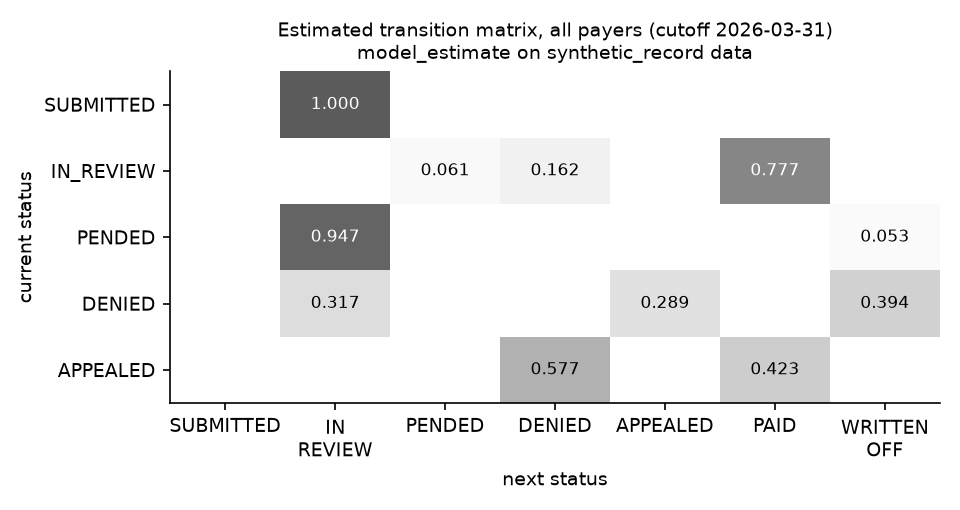
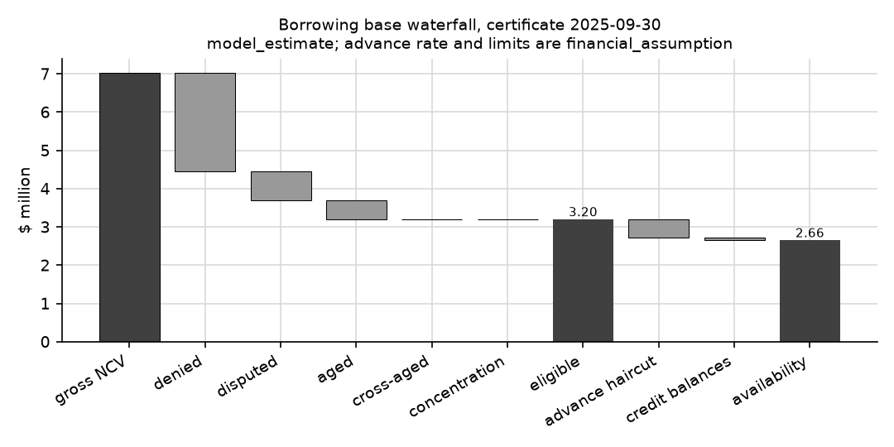
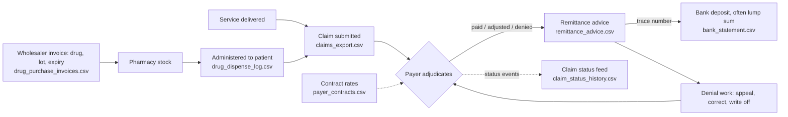
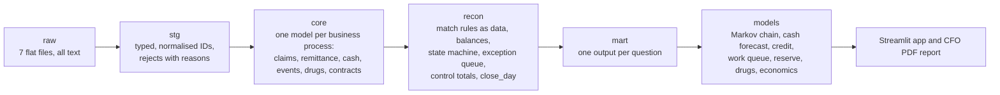

# Payment Reconciliation & Receivables Risk Engine

Money owed to a business passes through several hands before it lands in the bank, and some of
it gets lost on the way: a payment is short, a deposit arrives with no paperwork, a duplicate
line is posted twice. This project reconciles receivables three ways (billed, remitted,
deposited) to the cent in PostgreSQL, then answers seven decision questions on the reconciled
data: cash position, denial work queue, 13-week cash risk, unpaid-claims reserve, borrowing
base, drug margin and payer underpayment.

The core is industry-neutral: any business with invoices, payment advices and bank deposits has
the same problem. **Healthcare is the demonstration data set**, because one medical receivable
passes through a hospital, an insurer, a bank and a drug supplier. Every record belongs to a
**fictional** hospital ("Meridian Health System"), six fictional payers, one bank account and one
drug wholesaler. Only a few labelled calibration numbers come from public sources.

*Built with AI coding assistants from a written brief and design document; every number is reproducible with `python run_all.py`.*

## Results (simulated data, as of <!--n:recon.as_of_date-->2026-03-31<!--/n-->)

All numbers below are generated into [`docs/_numbers.md`](docs/_numbers.md) from `results/*.json`.
They show that the methods work and recover what the simulator planted. They are not findings
about real payers, hospitals or banks.

**Reconciliation (the primary test)**

| Check | Result |
|---|---|
| Raw rows landed | <!--n:recon.raw_rows_total-->276,008<!--/n--> raw rows across seven documents |
| Control totals, tied to the cent | <!--n:recon.control_checks-->24<!--/n--> checks, <!--n:recon.control_all_passed-->all passed<!--/n-->, largest difference <!--n:recon.control_max_diff-->$0.00<!--/n--> |
| Days closed by `recon.close_day` (refuses if one cent is off) | <!--n:recon.days_closed-->820<!--/n--> of <!--n:recon.days_total-->820<!--/n--> |
| Claim lines reconciled (billed = paid + contractual + denied + patient share + open) | <!--n:recon.claim_lines-->72,256<!--/n--> lines, <!--n:recon.billed_total-->$207,967,496.01<!--/n--> billed |
| Raw rows rejected in staging, each with a reason | <!--n:recon.staging_rejects-->519<!--/n--> |

**Matching quality on self-generated defects** (scored against the simulator's planted truth)

| Stage | Matched | Precision | Recall |
|---|---:|---:|---:|
| Remittance line to claim line | <!--n:recon.c2r.matched-->88,467<!--/n--> | <!--n:recon.c2r.precision-->1.0000<!--/n--> | <!--n:recon.c2r.recall-->0.9998<!--/n--> |
| Payment to bank deposit | <!--n:recon.r2b.matched-->1,103<!--/n--> | <!--n:recon.r2b.precision-->1.0000<!--/n--> | <!--n:recon.r2b.recall-->0.9616<!--/n--> |
| Duplicate remittance lines | <!--n:recon.dup.flagged-->356<!--/n--> flagged | <!--n:recon.dup.precision-->0.9972<!--/n--> | <!--n:recon.dup.recall-->1.0000<!--/n--> |

Where the rules are weak, by design (a rule accepts only a unique candidate; anything ambiguous
goes to a person):

| Hard case | Recall | What happens instead |
|---|---:|---|
| Transposed claim number and a twin visit (same member, date, code, charge) | <!--n:recon.case.twin.recall-->0.768<!--/n--> | <!--n:recon.case.twin.queued-->16<!--/n--> of <!--n:recon.case.twin.lines-->69<!--/n--> lines queued as AMBIGUOUS |
| Two equal provider payments, deposits without trace number | <!--n:recon.case.equal_untraced.recall-->0.345<!--/n--> | <!--n:recon.case.equal_untraced.queued-->36<!--/n--> of <!--n:recon.case.equal_untraced.payments-->55<!--/n--> queued as AMBIGUOUS |
| Split deposit whose second credit has no trace | <!--n:recon.case.split_untraced.recall-->0.000<!--/n--> | all <!--n:recon.case.split_untraced.payments-->8<!--/n--> sent to unapplied cash and "remitted, no deposit" |

These numbers measure consistency between this project's generator and its own rules. They are
not evidence of matching accuracy on real remittances.

**One headline per decision question**

| # | Who asks | Headline (simulated) | Label |
|---|---|---|---|
| 1 | Hospital CFO | <!--n:recon.unapplied.amount-->$2,048,321.11<!--/n--> of payer credits (<!--n:recon.unapplied.n-->64<!--/n--> items) are unapplied: <!--n:recon.unapplied.true-->12<!--/n--> are true deposits without a remittance, <!--n:recon.unapplied.manual-->52<!--/n--> are queued for manual matching (<!--n:recon.unapplied.ambiguous-->36<!--/n--> ambiguous, <!--n:recon.unapplied.split-->8<!--/n--> possible split, plus their untraced companions). Likewise <!--n:recon.remit_no_deposit.amount-->$1,596,219.08<!--/n--> on <!--n:recon.remit_no_deposit.n-->51<!--/n--> payments shows no deposit: <!--n:recon.remit_no_deposit.true-->7<!--/n--> truly missing, <!--n:recon.remit_no_deposit.manual-->44<!--/n--> whose deposit the rules queued instead of guessing | synthetic_record |
| 2 | Revenue-cycle lead | Today's queue, expected net: knapsack <!--n:q2.today_value-->$324,591<!--/n-->, largest-first <!--n:q2.today_largest-->$311,468<!--/n-->, oldest-first <!--n:q2.today_oldest-->$30,948<!--/n-->; realised in the 1 hour/day backtest <!--n:q2.bt1h_knap_realised-->$1,203,967<!--/n--> vs <!--n:q2.bt1h_largest_realised-->$1,182,127<!--/n--> (largest-first). The gain over largest-first is small: the overturn model's AUC <!--n:q2.auc_model-->0.631<!--/n--> is barely above a reason-code lookup (<!--n:q2.auc_reason-->0.626<!--/n-->) | model_estimate |
| 3 | Treasurer | 13-week cash forecast backtest: <!--n:cash.cov80-->79.1%<!--/n--> of weeks inside the 80% band, <!--n:cash.cov95-->96.1%<!--/n--> inside the 95% band (<!--n:cash.n_weeks-->741<!--/n--> forecast-weeks) | model_estimate |
| 4 | Payer actuary | Chain-ladder unpaid <!--n:q4.cl_unpaid-->$863,526<!--/n--> (90% interval <!--n:q4.boot_p05-->$590,325<!--/n--> to <!--n:q4.boot_p95-->$1,168,996<!--/n-->); simulator's true value <!--n:q4.true_unpaid-->$663,429<!--/n--> is inside, point estimate <!--n:q4.cl_error-->30%<!--/n--> high | model_estimate |
| 5 | Bank credit analyst | Borrowing base on <!--n:credit.certificate_date-->2025-09-30<!--/n-->: <!--n:credit.availability-->$2,656,726<!--/n--> available on <!--n:credit.eligible-->$3,204,908<!--/n--> eligible; expected loss <!--n:credit.expected_loss-->$662,340<!--/n--> is not covered by the lender's margin of <!--n:credit.lender_margin-->$480,736<!--/n--> | model_estimate, financial_assumption |
| 6 | Pharmacy manager | <!--n:q6.n_losing-->21<!--/n--> of <!--n:q6.n_drugs-->25<!--/n--> drugs lose money before patient share (<!--n:q6.n_losing_if_patient_pays-->12<!--/n--> if every patient share were collected); contracts cover cost by <!--n:q6.price_gap_m-->$12.3 million<!--/n--> but denials remove <!--n:q6.denied_leak_m-->$12.8 million<!--/n--> | model_estimate |
| 7 | Consulting economist | <!--n:q7.top_payer-->P03<!--/n--> underpays most: <!--n:q7.top_rate-->1.61%<!--/n--> of contract value (95% interval <!--n:q7.top_rate_ci-->1.15% to 2.15%<!--/n-->); appeal only above <!--n:q7.appeal_cost-->$45<!--/n--> / P(win) = <!--n:q7.threshold_min-->$93.23<!--/n--> to <!--n:q7.threshold_max-->$126.40<!--/n--> | model_estimate |




## Business flow



Money can be lost at every arrow. The engine checks each one.

## Architecture



All reconciliation logic lives in SQL (`sql/`, run in numbered order). Python generates the raw
documents, runs the SQL, fits the models and writes `results/`. Match rules are rows in
`recon.match_rule` (<!--n:repo.match_rules-->11<!--/n--> rules), so a tolerance changes with an `UPDATE`, not a code
change. Every match row records the rule that made it.

## The seven questions

| # | Who asks | Question | Method |
|---|---|---|---|
| 1 | Hospital CFO | How much did we really collect, and where is cash stuck? | three-way reconciliation, aging, P&L by payer and service line |
| 2 | Revenue-cycle lead | Which denied claims should staff work first today? | logistic overturn model, expected recovery minus handling cost, 0/1 knapsack under staff hours, compared with oldest-first |
| 3 | Treasurer | Will we be short of cash in the next 13 weeks? | payment-lag survival curves (Kaplan-Meier, lognormal), Monte Carlo, cash-at-risk and CVaR, coverage backtest |
| 4 | Payer actuary | How much is still owed on claims incurred but not yet paid? | development triangle in SQL, chain-ladder, Mack standard error, ODP bootstrap, Bornhuetter-Ferguson, frequency-severity |
| 5 | Bank credit analyst | How much can we lend against these receivables? | eligibility waterfall, concentration limit, advance rate, expected loss = PD x LGD x EAD, interest-rate stress |
| 6 | Pharmacy manager | Which drugs lose money after reimbursement? | FIFO lot costing in SQL, expiry waste, margin decomposition per drug |
| 7 | Consulting economist | Which payers underpay against contract, by how much, and why would they? | shortfall vs contract with claim-level bootstrap, value of float at SOFR, appeal break-even, repeated-game reading |

A shared building block feeds questions 3 to 5: the claim life cycle as an absorbing Markov chain
over <!--n:markov.n_states-->7<!--/n--> states, with fundamental matrix N = (I - Q)^-1 and absorption probabilities B = N R.
Estimated on <!--n:markov.n_transitions-->64,378<!--/n--> transitions, a submitted claim is eventually paid with probability
<!--n:markov.p_paid-->90.9%<!--/n--> (95% interval <!--n:markov.p_paid_ci-->90.6% to 91.3%<!--/n-->).

## How to run

Requires Python 3.13. From a fresh clone:

```bash
python3.13 -m venv .venv && source .venv/bin/activate
python -m pip install -r requirements.txt

# rebuild everything from nothing: generate raw files, build the database, reconcile,
# close every day, run the seven models, evaluate against planted truth, write results/
python run_all.py

# tests
python -m pytest

# refresh the numbers quoted in the documents, then the project dossier PDF (needs Tectonic)
python scripts/build_docs_numbers.py --apply
python scripts/build_dossier.py
```

The public CMS and FRED inputs are committed in `data/public/`; `python scripts/fetch_public_data.py`
downloads them again and rewrites `config/public_calibration.yaml`.

Start the app (it runs offline against the embedded database) with: **<!--n:repo.app_command-->python app/launch.py<!--/n-->**

The database is an embedded PostgreSQL 16 whose data directory lives outside the repository
(`~/.cache/receivables-engine/pg`, override with `RRE_PG_DIR`); set `DATABASE_URL` to use a hosted
server instead. The core database build and daily close took <!--n:recon.build_seconds-->63<!--/n--> seconds on a laptop; a full
`run_all.py` with the seven models takes about <!--n:repo.full_run_minutes-->5<!--/n--> minutes. The dossier build needs
[Tectonic](https://tectonic-typesetting.github.io) (set `TECTONIC=/path/to/tectonic` or put it on `PATH`). There are
<!--n:repo.tests-->183<!--/n--> automated tests, including tie-out tests that corrupt one cent and expect `close_day` to
refuse, and leakage tests that delete future data and expect earlier outputs not to change.

## Data and the five labels

The pipeline reads only seven flat files that imitate real exports (wide, repeated headers, text
dates, inconsistent identifiers): `claims_export.csv` (CMS-1500 / UB-04 lines),
`remittance_advice.csv` (835 / EOB lines), `bank_statement.csv`, `payer_contracts.csv`,
`drug_purchase_invoices.csv`, `drug_dispense_log.csv`, `claim_status_history.csv`. A seeded
generator writes them and plants realistic defects: duplicate lines, partial payments, reversals
and reposts, recoupments, mangled claim numbers, lockbox bundles, split deposits, deposits with no
remittance, truncated trace numbers, posting-date shifts and payments below contract. The planted
truth is written to `data/truth/`, which the pipeline is tested never to open.

Every number carries one of five labels:

| Label | Meaning | Example here |
|---|---|---|
| `observed_public` | measured directly in a public source | CMS Transparency in Coverage issuer denial rates, p10 <!--n:public.cms_p10-->9.0%<!--/n--> to p90 <!--n:public.cms_p90-->24.5%<!--/n--> over <!--n:public.cms_n_issuers-->134<!--/n--> issuers (<!--n:public.cms_year-->2025<!--/n--> data, computed by this project from CMS data); SOFR <!--n:public.sofr-->3.91%<!--/n--> |
| `published_aggregate` | a statistic a public body publishes | CMS Medicare Part B payment limits for <!--n:public.n_drugs-->25<!--/n--> drugs, <!--n:public.asp_quarter-->2026Q4<!--/n--> |
| `synthetic_record` | simulated demonstration record | every claim, remittance, deposit and invoice |
| `financial_assumption` | an assumed business parameter | advance rate <!--n:credit.advance_rate-->85%<!--/n-->, appeal cost <!--n:q2.appeal_cost-->$45<!--/n-->; also the simulated payers' first-pass denial rates (<!--n:public.denial_rate_min-->11.1%<!--/n--> to <!--n:public.denial_rate_max-->23.3%<!--/n-->), chosen at percentiles of the CMS distribution (a calibrated assumption) |
| `model_estimate` | estimated by a model in this repository | reserve, borrowing base, overturn probability |

Sources, retrieval dates, file hashes and what each source can and cannot support are in
[`docs/data_sources.md`](docs/data_sources.md).

## What simulated data can and cannot show

It **can** show that the pipeline ties out to the cent, that the rules find the planted defects
and refuse to guess on ambiguous ones, that each model recovers the parameters planted in the
generator, and that each decision rule behaves correctly (for example, the knapsack never picks a
claim past its appeal window).

It **cannot** show how often real payers underpay, how accurate the matching rules would be on
real 835 files, or whether any recommendation would save a real hospital money. The generator and
the rules were written by the same project, so matching scores are an internal-consistency check.
The economic reasoning about payer incentives is reasoning, not an effect measured in data.

## Limitations

- All transactional data are simulated. Real remittances contain codes, formats and edge cases
  this generator does not produce.
- The overturn model is weak (AUC <!--n:q2.auc_model-->0.631<!--/n-->) because simulated appeal outcomes are mostly noise:
  even the generator's own probabilities reach only <!--n:q2.auc_planted-->0.644<!--/n-->.
- The Markov chain is memoryless. A hold-out test shows claims that sat in DENIED were paid far
  less often (<!--n:markov.denied_observed-->25.2%<!--/n-->) than the plain chain predicted (<!--n:markov.denied_pred_memoryless-->50.2%<!--/n-->); a
  time-in-state correction brings the prediction to <!--n:markov.denied_pred_duration-->28.1%<!--/n-->.
- The simulated hospital stops billing after 2025-12-31, so at the as-of date the cash forecast
  and borrowing base describe a run-off book. Both models are therefore also evaluated at an
  earlier date while the hospital is still billing.
- Chain-ladder assumes stable payment patterns; it overstated the simulator's true unpaid amount by
  <!--n:q4.cl_error-->30%<!--/n-->, mostly because a few large claims dominate it.
- Advance rate, spread, age limit, appeal cost and staff hours are assumptions, labelled as such.
- Backtests also guided model design, so they are not clean hold-outs: the cash model's lag
  weighting was changed after the first backtest over-forecast, and the credit PD switched to the
  dollar-weighted chain after the expected-loss backtest. The coverage and expected-loss checks
  are therefore partly in-sample for the design choices.
- Public inputs postdate the simulated as-of date (<!--n:recon.as_of_date-->2026-03-31<!--/n-->): SOFR is the observation of
  <!--n:public.sofr_as_of-->2026-11-19<!--/n--> and the drug reference prices are the <!--n:public.asp_quarter-->2026Q4<!--/n--> CMS limits. They calibrate the
  simulation; they are not what was known on the as-of date.
- The drug margin is before patient share (<!--n:q6.patient_resp-->$3,471,232.73<!--/n--> on drug lines is treated as not
  collected): <!--n:q6.n_losing-->21<!--/n--> of <!--n:q6.n_drugs-->25<!--/n--> drugs lose money before patient share, <!--n:q6.n_losing_if_patient_pays-->12<!--/n--> if all of it were collected.
- Some control totals hold by construction: the claim-line identity is also a table CHECK
  constraint, so `CONTROL_IDENTITY_*` cannot fail on stored rows. The independent checks are the
  balance recompute from postings (`BALANCE_RECOMPUTE_MISMATCH`), the bank statement chain
  (`BANK_BALANCE_CHAIN_BREAKS`, `BANK_OPENING_PLUS_ACTIVITY`), the allocation checks
  (`ALLOCATION_INTEGRITY`, `PAYMENT_ALLOCATION_INTEGRITY`) and the raw-to-core row and money counts.
- No causal claims: nothing here identifies why a payer behaves as it does.

## Repository map

```
run_all.py                  one command: generate, build, reconcile, close, model, evaluate
config/                     generator calibration and public calibration (with labels and sources)
sql/                        raw -> stg -> core -> recon -> mart, numbered; sql/models/ per question
src/recon_engine/           generator, pipeline, db connection, labels, CLI, models/
app/                        Streamlit app, one screen per question
tests/                      tie-out, close_day refusal, leakage, determinism, model checks
results/                    generated JSON per model and summary.md (never hand-written)
figures/                    generated figures
docs/                       design, data dictionary, data sources, rulebook, decision log,
                            model notes, consulting memo, _numbers.md, one-pagers,
                            project_dossier/ (40-50 page PDF)
practice/                   two timed technical tests, SQL drills, domain questions, solutions
scripts/                    public-data fetch, model runners, evaluation, docs numbers, dossier
```

## Licence and data terms

- **Code:** MIT licence (see `LICENSE`).
- **Public data** belong to their owners and keep their own terms (details in
  `docs/data_sources.md`):
  - CMS (Transparency in Coverage PUF, Medicare Part B payment limits): cite CMS as the source.
    Figures this project derived from CMS files, such as payer denial-rate percentiles, are
    **computed by this project from CMS data** and are not CMS statistics.
  - FRED: SOFR is "Copyrighted: Citation Required". Cite: Federal Reserve Bank of New York,
    Secured Overnight Financing Rate [SOFR], retrieved from FRED, Federal Reserve Bank of St. Louis.
    DGS3MO is public domain, citation requested (Board of Governors of the Federal Reserve System
    via FRED).
  - KFF figures are quoted unaltered with attribution under KFF's CC BY-NC-ND 4.0 terms.
- The downloaded public files are committed in `data/public/` under their owners' terms above;
  `scripts/fetch_public_data.py` re-fetches them and records URL, date and SHA-256 in
  `data/public/manifest.json`.

Nothing in this repository describes a real hospital, insurer, bank or patient, or work done for
any employer.
