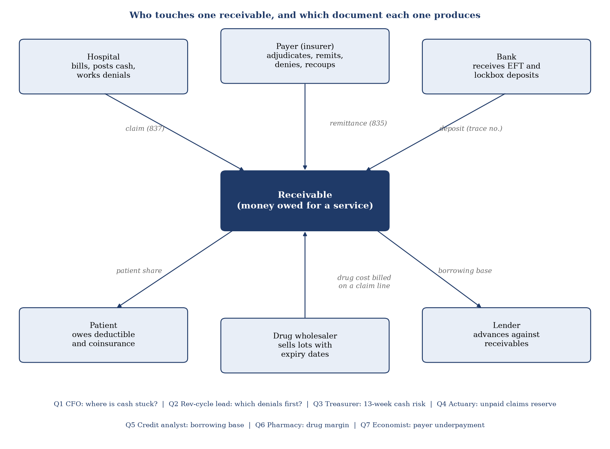
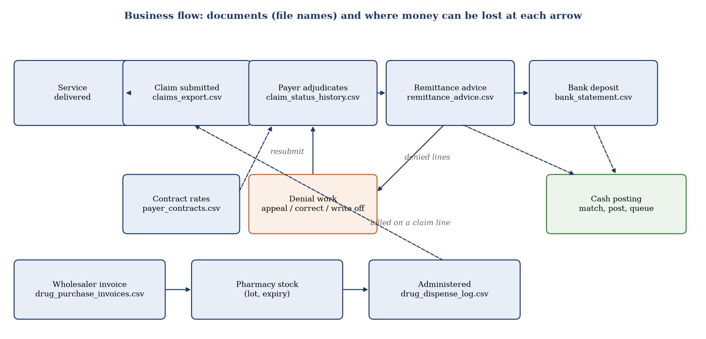

%% \newpage
# Business conception

## What, who, when, how

The project started from the business flow, not from tools. Before any table was designed, the
questions below were fixed.

| Concept | Answer |
|---|---|
| What is reconciled? | Receivables: what was billed (claim lines), what the payer says it paid (remittance lines grouped into payments), what arrived in the bank (deposits). |
| Who produces each document? | The hospital (claim export, claim status feed, pharmacy dispense log), the payer (remittance advice, contract rates), the bank (statement), the wholesaler (drug invoices). |
| Who uses the result? | Cash posting and reconciliation staff, the revenue-cycle lead, the CFO, the treasurer, the payer's actuary, a bank credit analyst, the pharmacy manager, a consulting economist. |
| When does it run? | Daily: new files land, the engine reconciles incrementally, and `recon.close_day` verifies and closes each business day in order. Models refresh on the reconciled data. |
| How is correctness shown? | Identities that must tie to the cent, a close procedure that refuses on a one-cent break, and, because the data are simulated, comparison with the generator's planted truth. |
| What is out of scope? | Real patient data, provider-level (PLB) reconciliation against claims, payer-side adjudication logic, and any claim about real payers. |

{width=0.8}

The engine does not depend on healthcare. Any company that is owed money works with the same
three documents: the invoice it sent, the payment advice that says what the customer meant to
pay, and the bank statement that shows what really arrived. A bank's settlement team reconciles
card, ACH and wire payments the same way. Healthcare is the example because one medical bill
passes through a hospital, an insurer, a bank and a drug supplier, so a single data set answers
questions for all four.

## Business flow

{width=0.92}

1. **Service and claim.** A patient is treated. The hospital bills the payer on a claim (CMS-1500
   for professional services, UB-04 for institutional), one line per service, with a charge,
   procedure code, units and a line control number.
2. **Adjudication.** The payer reviews the claim (status feed: submitted, in review, pended) and
   decides each line: pay at the contract rate, adjust, or deny with a reason code.
3. **Remittance.** The payer sends a remittance advice (an 835 file or paper EOB). For each claim
   line it reports charge, allowed, paid, adjustments by group and reason code (CO contractual,
   PR patient responsibility) and the payer's own claim number. Lines are grouped into a payment
   with a trace number (EFT trace or check number).
4. **Cash.** Money arrives in the bank. An EFT credit carries the trace number in its description
   (unless the bank truncates it); checks are bundled into lockbox deposits ("ITEMS n"). One deposit
   can cover several payments; one payment can arrive in two deposits; a credit can arrive with no
   remittance at all.
5. **Posting and follow-up.** The hospital posts cash to claim lines, books contractual
   adjustments and patient balances, and works denials: appeal, correct and resubmit, or write off.
   Reversals (status 22) undo earlier postings; recoupments take money back.
6. **Drugs.** High-cost drugs are bought by lot with an expiry date, stored, administered, billed
   on a claim line and reimbursed weeks later, if the claim is not denied.

## Where money can be lost, and which control catches it

| Link | What goes wrong | Control in this project |
|---|---|---|
| Claim to remittance | claim number padded, prefixed, punctuated, transposed | rules CR10, CR20, CR30; ambiguous items queued |
| Remittance file | verbatim duplicate lines | DUP10 (claim-aware), duplicates excluded from posting |
| Remittance file | reversal of a posting that never arrived | REV10 pairing; `ORPHAN_REVERSAL` exception and line status |
| Payment header | header total differs from its lines | `TRACE_TOTAL_MISMATCH` exception, `TRACE_HEADER_EXPLAINED` control |
| Remittance to bank | truncated trace, date shift, lockbox bundle, split deposit | rules RB10 to RB40 |
| Bank | deposit with no remittance | `UNAPPLIED_CASH` exception, cash identity bank side |
| Bank | remittance with no deposit | `REMIT_NO_DEPOSIT` exception after the in-transit window |
| Contract | payer allows less than the contract | `UNDERPAYMENT` exception (rule UP10), Q7 analysis |
| Claim line | postings exceed the charge | `CREDIT_BALANCE` exception (money owed back) |
| Raw files | unreadable amounts or dates, repeated rows | staging rejects, `RAW_ROWS_ACCOUNTED` control |

## The seven questions and who asks them

| # | Role | Decision question | Output |
|---|---|---|---|
| 1 | Hospital CFO | How much did we really collect, and where is cash stuck? | `mart.cash_position`, `mart.cash_stuck`, `mart.ar_aging`, `mart.pnl_by_payer_service` |
| 2 | Revenue-cycle lead | Which denied claims should staff work first today? | `mart.work_queue` |
| 3 | Treasurer | Will we be short of cash in the next 13 weeks? | `mart.cash_forecast` |
| 4 | Payer actuary | How much is still owed on claims incurred but not yet paid? | `mart.dev_triangle`, reserve tables |
| 5 | Bank credit analyst | How much can we lend against these receivables? | `mart.borrowing_base` |
| 6 | Pharmacy manager | Which drugs lose money after reimbursement? | `mart.drug_fifo`, `mart.drug_margin` |
| 7 | Consulting economist | Which payers underpay against contract, by how much, and why would they? | `mart.underpayment`, consulting memo |

A question is kept only if its answer changes what someone does: which denied claims to work
today, how much a bank can lend, which contract term to renegotiate. A number like "claims per
day" is interesting but nobody acts on it. So every question has a named person who asks it, the
decision it feeds, and one output table that the app and the CFO report read directly.
