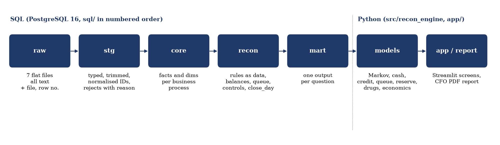
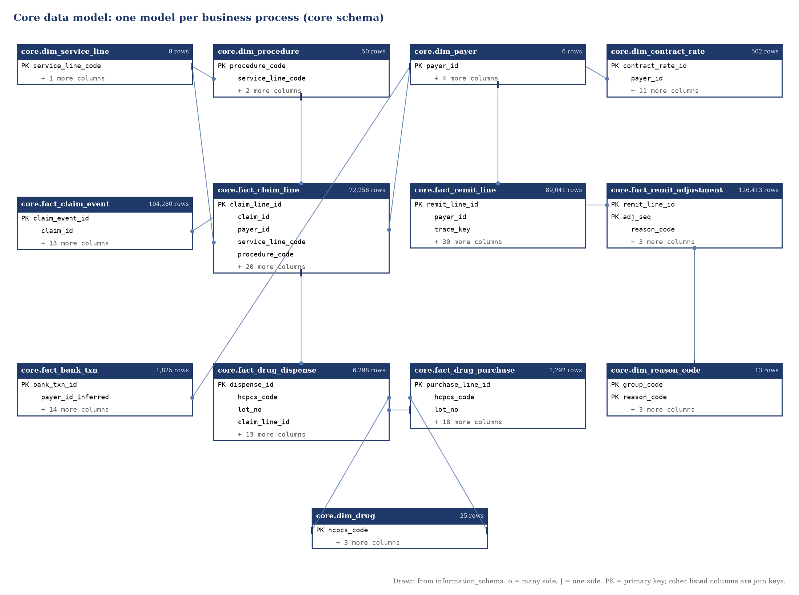
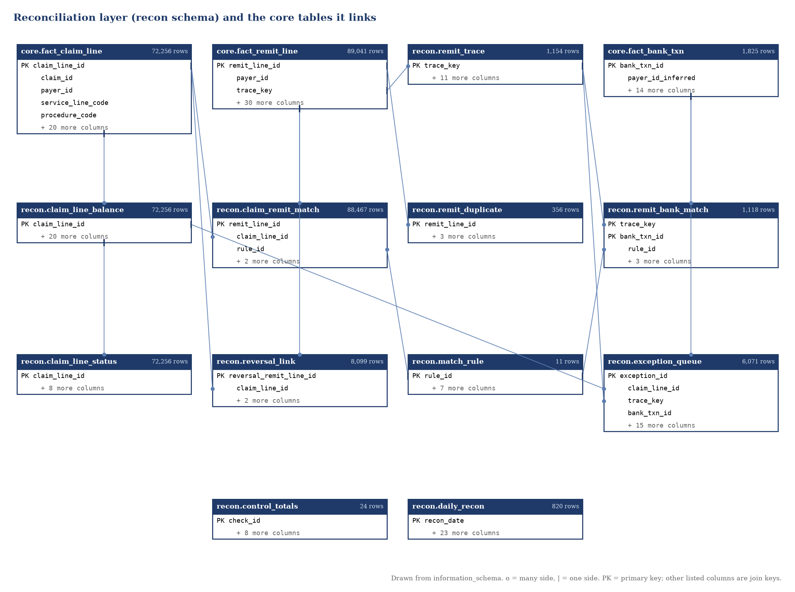

%% \newpage
# Architecture and data model

## Layers

{width=0.98}

| Schema | Purpose | Examples |
|---|---|---|
| `raw` | files as landed, every column text, plus file name, row number and load time | `raw.claims_export` |
| `stg` | typed and trimmed rows, normalised identifiers, rejects with reasons | `stg.claim_line`, `stg.reject` |
| `core` | one data model per business process | `fact_claim_line`, `fact_remit_line`, `fact_bank_txn`, `fact_claim_event`, `fact_drug_purchase` |
| `recon` | matches, balances, claim-line state machine, exception queue, control totals, daily close | `claim_remit_match`, `claim_line_balance`, `exception_queue`, `daily_recon` |
| `mart` | one output per decision question, each table labelled | `cash_stuck`, `ar_aging`, `work_queue`, `borrowing_base` |

All SQL lives in `sql/` as numbered files that `src/recon_engine/pipeline.py` runs in order: files
starting with `0` (schemas, raw tables, parse functions, rules and reference data) run before the
raw files are landed, the rest after. Model SQL lives in `sql/models/` and is run by each model.
The same functions serve a full rebuild and incremental intake (`stg.process_new()`,
`core.process_new()`, `recon.run_all()`, `mart.refresh_q1()`): they touch only rows not yet
processed, keyed on file and row number, while derived tables are rebuilt from core each run so
they cannot drift (decision D-005).

## One data model per business process

The core schema is not a generic star schema with customer, product and date. Each business
process has its own fact table at its natural grain: one row per claim line for claims, one row
per adjudicated line or adjustment for remittances, one row per bank transaction for cash, one
row per status change for the claim life cycle, one row per lot for drug purchases and one row
per administration for drug dispensing. The dimensions are what those processes share: payer,
procedure, service line, reason code, drug and contract rate. Keeping each grain separate is what
keeps the reconciliation joins from double counting.

| Process | Fact table (grain) | Rows | Main dimensions |
|---|---|---:|---|
| Claim submission | `core.fact_claim_line` (claim line) | <!--n:recon.claim_lines-->72,256<!--/n--> | payer, procedure, service line |
| Remittance | `core.fact_remit_line` (adjudicated line) | <!--n:recon.remit_lines-->89,041<!--/n--> | payer, reason code |
| Cash | `core.fact_bank_txn` (bank transaction) | <!--n:recon.bank_txns-->1,825<!--/n--> | payer (inferred) |
| Claim life cycle | `core.fact_claim_event` (status event) | <!--n:recon.claim_events-->104,280<!--/n--> | reason category |
| Drug purchase | `core.fact_drug_purchase` (lot) | <!--n:recon.raw_rows.invoices-->1,292<!--/n--> | drug |
| Drug dispensing | `core.fact_drug_dispense` (event) | <!--n:recon.raw_rows.dispense-->6,298<!--/n--> | drug, claim line |

## Entity-relationship diagrams

The two panels below are drawn by `scripts/build_dossier.py` from the live database's
`information_schema` (snapshot in `docs/project_dossier/schema_snapshot.json`), so table names, key
columns and row counts are the real ones. Only declared primary keys and join columns are listed;
the remaining columns are counted. Most relationships are logical joins rather than declared
foreign keys, because staging rejects mean some references legitimately point nowhere (for
example a remittance for a claim line rejected in staging), and those cases must reach the
exception queue instead of failing an insert.

{width=1.0}

{width=1.0}

## Design choices that matter

- **Money is `numeric(14,2)`, never float**, and the generator writes integer cents. One cent off
  always means a real defect (decision D-001; a test checks every money column's type).
- **Rules are data.** `recon.match_rule` holds rule id, stage, method, priority, amount tolerance,
  date window and an active flag; every match row stores the rule that produced it. A tolerance
  changes with an `UPDATE`, not a code change (D-006).
- **Unique candidate or nothing.** No rule picks the best of several equal candidates (D-007).
- **Many-to-many payment to deposit.** `recon.remit_bank_match` has one row per (payment, deposit),
  so lockbox bundles and split deposits are both representable (D-011).
- **Provider-level payments are not claim money.** PLB rows are flagged and held in suspense
  (D-012).
- **The embedded database lives outside the repository** (`~/.cache/receivables-engine/pg`),
  because the repository sits in a cloud-synced folder whose path breaks Unix sockets (D-002).
- **Ground truth is isolated.** The generator writes planted truth to `data/truth/`; pipeline code
  never opens it, which a static test and a runtime audit-hook test both check (D-014).
