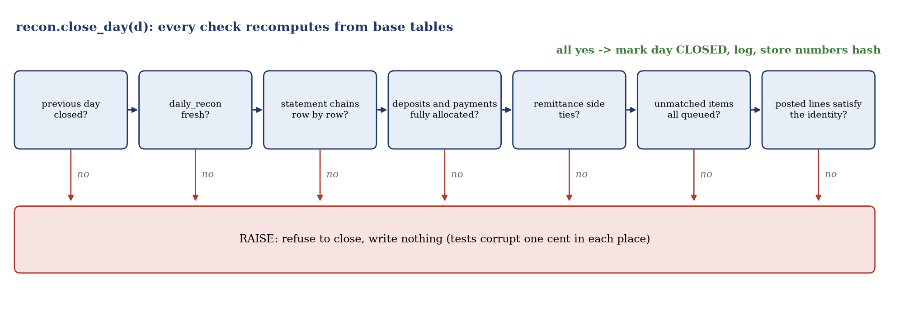

%% \newpage
# Control framework

## Identities that must tie to the cent

Per claim line, enforced by a CHECK constraint on `recon.claim_line_balance` and recomputed
independently by the controls:

\[
\text{billed} = \text{paid} + \text{contractual} + \text{denied} + \text{patient responsibility} + \text{open balance}
\]

For cash, on the payer side and on the bank side:

\[
\sum \text{payments (header totals)} = \text{matched deposits} + \text{unmatched remittances} + \text{timing differences}
\]
\[
\sum \text{payer credits} = \text{allocated to payments} + \text{unapplied cash}
\]

<!-- [Thuc: rewrite in your own words] --> The identities are written so that they hold whatever the
matching rules decide. An item the rules decline to match is not dropped: it sits in an explicit
bucket (unmatched remittance, unapplied cash, in transit), and the bucket is part of the identity.
So the totals tie to the cent even on the hard cases, and the control totals test the
bookkeeping, not the luck of the matching. If a total does not tie, something was lost or counted
twice, and that is always a bug.

## The control totals

Every run writes `recon.control_totals`. In the current build all <!--n:recon.control_checks-->24<!--/n--> checks passed, with a largest
difference of <!--n:recon.control_max_diff-->$0.00<!--/n-->. Not all of them are independent: the claim-line identity is also a
CHECK constraint, so `CONTROL_IDENTITY_*` cannot fail on stored rows. The independent checks are
`BALANCE_RECOMPUTE_MISMATCH` (stored components against a fresh sum of postings), the bank chain
(`BANK_BALANCE_CHAIN_BREAKS`, `BANK_OPENING_PLUS_ACTIVITY`), the allocation checks and the raw-to-core
row and money counts.

@@table:control_totals@@

What each family proves:

- `RAW_ROWS_ACCOUNTED`: no raw row disappears between landing and staging (raw = staged + rejected).
- `STG_TO_CORE_ROWS`: no staged row disappears between staging and core.
- `BILLED_ACCOUNTED`, `REMIT_PAID_ACCOUNTED`: money read from the raw files equals money in core plus
  rejected rows.
- `REMIT_POSTING_SPLIT`: remittance paid in core = posted to claim lines + excluded duplicates +
  unmatched (queued) + provider-level suspense.
- `CONTROL_IDENTITY_*`, `BALANCE_RECOMPUTE_MISMATCH`, `BILLED_TIES_TO_CORE`: the claim-line identity
  holds on every line and in total, and the stored components equal a fresh sum of postings.
- `BANK_BALANCE_CHAIN_BREAKS`, `BANK_OPENING_PLUS_ACTIVITY`: the statement chains row by row.
- `CASH_REMIT_SIDE`, `CASH_BANK_SIDE`, `ALLOCATION_INTEGRITY`, `PAYMENT_ALLOCATION_INTEGRITY`,
  `TRACE_HEADER_EXPLAINED`: the two cash identities and the allocation of every deposit and payment.

## Daily close: `recon.close_day(d)`

{width=0.98}

`recon.close_day(d)` closes one business day. It refuses, raising an error and writing nothing, if
the previous day is not closed, `daily_recon` is stale, the statement does not chain row by row, a
deposit or payment is not fully allocated, the remittance side leaves a difference, any unmatched
item of that day is missing from the queue, or a claim line posted that day fails the identity or
differs from a fresh sum of its postings. It recomputes the day from base tables
(`recon.daily_numbers(d, d)`) instead of trusting stored numbers, which is the point of a control.
On success it marks the day CLOSED, logs the attempt in `recon.day_close_log` and stores a hash of
the day's numbers.

The current build closed <!--n:recon.days_closed-->820<!--/n--> of <!--n:recon.days_total-->820<!--/n--> days. The close loop is the largest part of build time
(<!--n:recon.close_seconds-->41<!--/n--> seconds of <!--n:recon.build_seconds-->63<!--/n-->); `docs/sql_notes.md` records how missing planner statistics once
turned a short build into several minutes and how an explicit `ANALYZE` fixed it.

Tests in `tests/test_core_close_day.py` corrupt one cent in a bank amount, remove a deposit match,
tamper with a claim balance, make an allocation partial and try to close out of order; each must be
refused. A further test updates one cent of a stored balance and expects the CHECK constraint to
raise.

<!-- [Thuc: rewrite in your own words] --> Why a close procedure rather than a report? In finance a day, or
a month, is either closed or it is not. Once it is closed, later work must not silently change it.
The procedure makes that rule executable: it is the gate between "data arrived" and "numbers we
stand behind". It also forces order, because a day cannot close before the day before it.

## The exception queue

Every unresolved item is one row in `recon.exception_queue` with a stable key (TYPE:id), a
severity, the amount, the reason and the rule involved. A run re-opens items it still finds and
marks the rest CLEARED, so the queue shows what changed when new data arrive. Open items in the
current build:

@@table:exceptions@@

| Type | Who acts | Typical resolution |
|---|---|---|
| `UNMATCHED_REMIT` | cash posting | check the payer claim number (ICN) on the portal; fix the claim if it was rejected |
| `UNAPPLIED_CASH` | cash posting | request the missing 835 from the payer; allocate split deposits by hand |
| `REMIT_NO_DEPOSIT` | treasury | trace the payment with the payer's bank |
| `CREDIT_BALANCE` | refunds | confirm the overpayment and refund or wait for recoupment |
| `UNDERPAYMENT` | contract variance | dispute above the payer's appeal threshold (Q7) |
| `ORPHAN_REVERSAL`, `STALE_REVERSAL` | cash posting, follow-up | obtain the missing original or the repost |
| `NO_RESPONSE` | follow-up | claim status inquiry after 90 days |
| `STAGING_REJECT` | data steward | correct the source row and reload |
| `PROVIDER_LEVEL_PAYMENT` | reimbursement | reconcile periodic payments outside claim posting |

## Where cash is stuck (question 1)

The CFO's view, `mart.cash_stuck`, reads the queue and the balances into buckets:

@@table:cash_stuck@@

These buckets are the answer to "where is cash stuck", with one caution: unapplied cash and
"remitted, no deposit" mix true gaps with items the rules queued for manual matching. Of
<!--n:recon.unapplied.n-->64<!--/n--> unapplied credits, <!--n:recon.unapplied.true-->12<!--/n--> are true deposits without a remittance; <!--n:recon.unapplied.ambiguous-->36<!--/n--> are
ambiguous and <!--n:recon.unapplied.split-->8<!--/n--> possible splits. Of <!--n:recon.remit_no_deposit.n-->51<!--/n--> payments with no matched deposit, <!--n:recon.remit_no_deposit.true-->7<!--/n--> are truly missing. Denied lines on written-off claims are lost
revenue rather than stuck cash; they are shown so the CFO sees the size of the denial problem. The
P&L by payer and service line (`mart.pnl_by_payer_service`) and the aging (`mart.ar_aging`)
complete question 1; the CFO PDF report is built from these marts.
