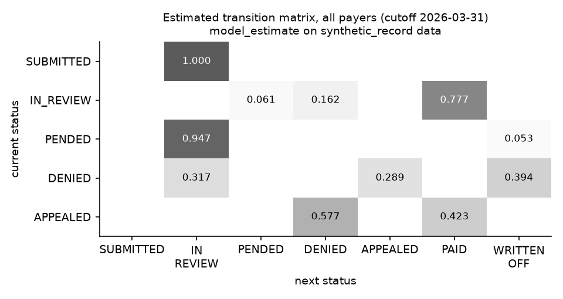

%% \newpage
# Models on the reconciled data

Each model follows the same standard: it answers one named question for one role; it reads only
the database and the labelled configuration (never the generator's settings or truth); it is fit
on data before a cutoff and evaluated after it, with a test proving later data cannot change
earlier outputs; and, because the data are simulated, it reports two things only: how well it
recovers what the generator planted, and whether the decision rule behaves correctly. Weak results
are reported as weak.

## Shared building block: the claim life cycle as an absorbing Markov chain

**Question.** From each state of its life cycle, what is the probability that a claim is eventually
paid, and how many steps does resolution take? The result feeds the cash forecast (Q3), expected
loss in the borrowing base (Q5) and the reserve discussion (Q4).

**Data.** `core.fact_claim_event` (<!--n:recon.claims-->30,058<!--/n--> claims), <!--n:markov.n_transitions-->64,378<!--/n--> observed transitions between
<!--n:markov.n_states-->7<!--/n--> states: SUBMITTED, IN_REVIEW, PENDED, DENIED, APPEALED (transient) and PAID, WRITTEN_OFF
(absorbing). Exits from states entered less than <!--n:markov.maturity_days-->180<!--/n--> days before the cutoff are dropped so that
slow paths are not under-represented (an assumption).

**Method.** The maximum-likelihood transition probability is the share of observed exits:
\[
\hat P_{ij} = \frac{n_{ij}}{\sum_k n_{ik}}
\]
Ordering states as transient then absorbing, the matrix has blocks
\[
P = \begin{pmatrix} Q & R \\ 0 & I \end{pmatrix},\qquad N = (I - Q)^{-1},\qquad B = N R,\qquad t = N\mathbf{1}.
\]
\(N_{ij}\) is the expected number of visits to transient state \(j\) starting from \(i\); \(B_{ik}\) is
the probability of ending in absorbing state \(k\); \(t_i\) is the expected number of steps to
absorption. Intervals come from a claim-level bootstrap (whole claim histories resampled).

Estimated transition matrix, all payers:

@@table:markov_matrix@@

**Results.** A submitted claim is eventually paid with probability <!--n:markov.p_paid-->90.9%<!--/n--> (95% interval
<!--n:markov.p_paid_ci-->90.6% to 91.3%<!--/n-->); across payers the range is <!--n:markov.p_paid_min-->85.7%<!--/n--> to <!--n:markov.p_paid_max-->94.2%<!--/n-->. Once denied, the
probability of eventual payment falls to <!--n:markov.p_paid_from_denied-->49.2%<!--/n-->. Resolution takes <!--n:markov.steps_from_submitted-->2.49<!--/n--> transitions on
average from SUBMITTED.

{width=0.72}

**Validation.** Against the generator's planted population matrix, the largest absolute error of
any estimated transition probability over all payers is <!--n:markov.max_abs_error-->0.058<!--/n-->, and the planted probability of
payment lies inside the bootstrap 95% interval for <!--n:markov.planted_inside-->6<!--/n--> of 6 payers
(`results/markov_validation.json`). A unit test reproduces a 3-state example by hand.

**Testing the Markov assumption.** The chain assumes the next state depends only on the current
one. Three chi-square tests of homogeneity reject that: the step after DENIED depends on the
denial reason (chi-square <!--n:markov.chi2_after_denied-->2136<!--/n-->), appeal outcomes depend on the reason, and a later review is
denied more often than a first one (<!--n:markov.review_denied_later-->19.7%<!--/n--> against <!--n:markov.review_denied_first-->15.7%<!--/n-->). On hold-out data (fit at an
earlier cutoff, outcomes observed later), the plain chain predicted <!--n:markov.denied_pred_memoryless-->50.2%<!--/n--> of claims sitting in
DENIED would be paid; <!--n:markov.denied_observed-->25.2%<!--/n--> were. A time-in-state correction, which conditions on how long a
claim has already waited, predicts <!--n:markov.denied_pred_duration-->28.1%<!--/n-->. Hold-out Brier scores: constant rate
<!--n:markov.brier_constant-->0.1073<!--/n-->, plain chain <!--n:markov.brier_memoryless-->0.0855<!--/n-->, corrected chain <!--n:markov.brier_duration-->0.0799<!--/n-->.

The Markov chain stays in even though its main assumption fails, because the direction of the
failure is known and its size is measured. Every number in the chain is a simple count ratio that
a finance manager can check by hand, which makes it a good baseline for open receivables. It
breaks for claims that have already sat in DENIED for a long time, so a simple time-in-state
correction is added and its effect is shown on hold-out data. The assumption is tested instead of
taken for granted.

**Limits.** Payer-level matrices pool claims of different sizes and reasons; the dollar-weighted
version used for expected loss is a separate estimate. Simulated life cycles are cleaner than real
ones (no corrected claims with new numbers, no secondary payers).
