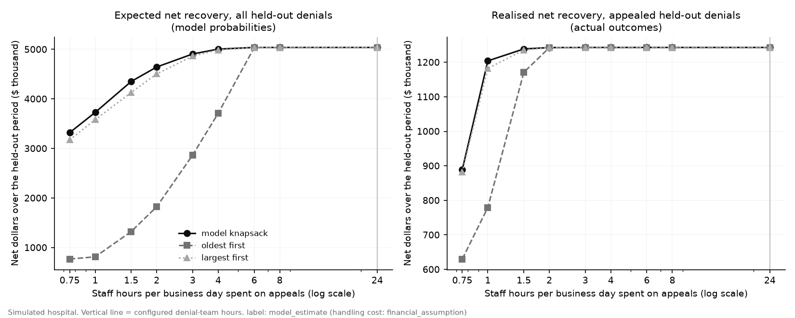

## Q2. Which denied claims should staff work first today?

**Who asks.** The revenue-cycle lead, every morning, with a fixed number of staff hours.

**Data.** `mart.denial_episodes(d)`: one row per DENIED event as known on date \(d\), with what
happened next. Training set: <!--n:q2.train_appeals-->1,079<!--/n--> appeals decided before the cutoff <!--n:q2.cutoff-->2025-07-01<!--/n-->; test set:
<!--n:q2.test_appeals-->442<!--/n--> later appeals with known outcomes. Money comes from the reconciliation core (contract allowed
per claim, payer paid ratio).

**Method.**

1. *Overturn model.* Logistic regression (statsmodels GLM, binomial, logit link):
   \(\operatorname{logit} P(\text{overturn}) = \beta_0 + \beta_{\text{payer}} + \beta_{\text{reason}} + \beta_{\text{service line}} + \beta_a(\ln \text{charge} - \overline{\ln \text{charge}}) + \beta_g\,\text{age}\).
2. *Value of working claim i.*
   \[
   V_i = p_i R_i - c_i,\qquad V_i = 0 \text{ once the appeal window has closed,}
   \]
   with \(R_i\) the contract allowed amount times the payer's paid ratio and \(c_i\) the staff cost
   of the appeal (minutes times a loaded hourly cost; appeal cost <!--n:q2.appeal_cost-->$45<!--/n-->, window <!--n:q2.appeal_window-->90<!--/n--> days, both
   assumptions).
3. *Today's list: an exact 0/1 knapsack.* Maximise \(\sum_i V_i x_i\) subject to
   \(\sum_i m_i x_i \le M\), \(x_i \in \{0,1\}\), by dynamic programming over integer minutes. With
   equal minutes it reduces to sorting by value, which a test checks.
4. *Backtest.* A day-by-day replay from the cutoff: each policy (knapsack, oldest first, largest
   first) works claims inside the appeal window under the same daily hours.

**Validation.**

@@table:q2_metrics@@

The planted coefficients lie inside their 95% intervals for <!--n:q2.coef_coverage-->19 of 19<!--/n--> terms (correlation of estimates
with planted values <!--n:q2.coef_corr-->0.91<!--/n-->). Calibration slope <!--n:q2.calib_slope-->0.84<!--/n--> (95% interval <!--n:q2.calib_slope_ci-->0.47 to 1.20<!--/n-->). On overturned
held-out appeals, realised payment divided by predicted recoverable amount is <!--n:q2.recoverable_ratio-->0.941<!--/n-->.

The overturn model is weak, and this chapter says so. On held-out appeals it does no better
than a simple table of overturn rates by denial reason. The data explain why: even the
generator's true probabilities only reach an AUC of <!--n:q2.auc_planted-->0.644<!--/n-->, so appeal outcomes are mostly
noise and there is little signal to find. The estimated coefficients still land close to the
planted ones, which shows the estimation is correct; the sample is just small for the number of
parameters.

**Decision quality.** On the as-of date, <!--n:q2.today_candidates-->151<!--/n--> denied claims wait for action. The knapsack chooses
<!--n:q2.today_selected-->48<!--/n--> of them, using <!--n:q2.today_minutes-->1,439<!--/n--> of <!--n:q2.budget_minutes-->1,440<!--/n--> minutes, for an expected net value of <!--n:q2.today_value-->$324,591<!--/n-->; with the
same budget, oldest first gives <!--n:q2.today_oldest-->$30,948<!--/n--> and largest first <!--n:q2.today_largest-->$311,468<!--/n-->. In the replay, valued with
the generator's probabilities (not circular):

@@table:q2_backtest@@

At one hour a day a knapsack that knows the planted probabilities reaches <!--n:q2.bt1h_oracle-->$3,705,282<!--/n-->; the fitted model
reaches <!--n:q2.bt1h_knap_planted-->$3,693,432<!--/n-->. Value is dominated by claim size: largest first comes close, oldest first
loses heavily when hours are scarce, and above a few hours a day every rule gives the same result
because the budget no longer binds (about <!--n:q2.denials_per_day-->10.1<!--/n--> new denials per business day). Realised dollars on
appealed claims at one hour a day: knapsack <!--n:q2.bt1h_knap_realised-->$1,203,967<!--/n-->, largest first <!--n:q2.bt1h_largest_realised-->$1,182,127<!--/n-->. Plainly: the
model's gain over a simple largest-first rule is small, consistent with its AUC of <!--n:q2.auc_model-->0.631<!--/n--> against
<!--n:q2.auc_reason-->0.626<!--/n--> for a lookup table; the large gain is only against oldest first.

{width=0.78}

**Limits.** Outcomes are observed only for claims the hospital chose to appeal; in the generator
that choice depends only on the reason, so real data would need a selection model. The value is
myopic (no option value of waiting). Effort multipliers, appeal window, cost and hours are
assumptions.
