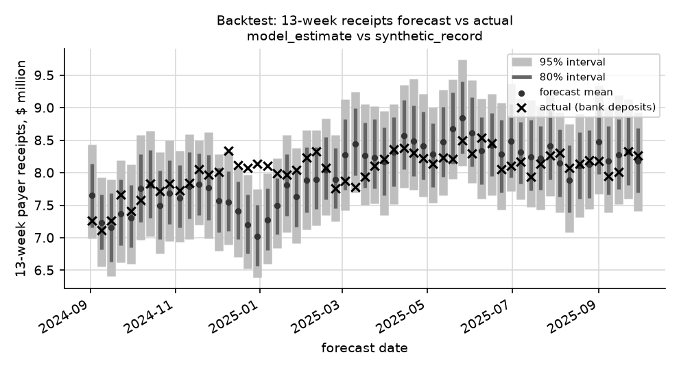

## Q3. Will we be short of cash in the next 13 weeks?

**Who asks.** The treasurer, who must keep the operating account above a minimum balance.

**Data.** Open claim lines and their states, payment lags from submission to payment (first-pass
and after denial), deposit lags from remittance to bank, the opening bank balance; all from the
reconciled core.

**Method.**

1. *Payment-lag distributions with right censoring.* For claims not yet paid, we only know the lag
   exceeds the time so far. Kaplan-Meier:
   \[
   \hat S(t) = \prod_{t_j \le t}\left(1 - \frac{d_j}{n_j}\right),
   \]
   with \(d_j\) payments at lag \(t_j\) and \(n_j\) claims still at risk. Lognormal, gamma and
   Weibull fits maximise a likelihood in which censored claims contribute \(S(t)\) rather than
   \(f(t)\); AIC picks the form (lognormal for <!--n:cash.lognormal_best-->6 of 6<!--/n--> payers). The forecast uses a hybrid:
   Kaplan-Meier where the risk set is large, the parametric tail beyond.
2. *Monte Carlo.* For each of <!--n:cash.n_sims-->2,000<!--/n--> paths, every open claim is paid or not (probability from the
   chain with the time-in-state correction), at a lag drawn from the conditional distribution given
   its age; new claims arrive at the estimated daily rate; receipts are summed by week.
3. *Risk measures.* Cash-at-risk (95%) = mean 13-week receipts minus their 5th percentile. With a
   weekly cash need and a minimum balance (assumptions), the shortfall on a path is the funding
   needed to stay above the minimum; CVaR is its mean in the worst 5% of paths.
4. *Backtest.* Forecasts from <!--n:cash.n_forecasts-->57<!--/n--> weekly origins, each using only data dated by its origin,
   scored on <!--n:cash.n_weeks-->741<!--/n--> forecast-weeks.

**Results.** In the backtest <!--n:cash.cov80-->79.1%<!--/n--> of weeks fell inside the 80% interval and <!--n:cash.cov95-->96.1%<!--/n--> inside the
95% interval; <!--n:cash.cov80_total-->87.7%<!--/n--> of 13-week totals fell inside their 80% interval; mean absolute error is
<!--n:cash.mape_weekly-->18.5%<!--/n--> per week and <!--n:cash.mape_13w-->3.4%<!--/n--> for the 13-week total. The Wilson interval around the 80%
coverage (<!--n:cash.cov80_ci-->76.0% to 81.9%<!--/n-->) is too narrow because overlapping windows are dependent.

Because the simulated hospital stops billing after 2025-12-31, the forecast at the as-of date is a
run-off of the open book, not a going concern. The treasurer's question is therefore asked at
<!--n:cash.question_date-->2025-09-29<!--/n-->, while the hospital is still billing: mean 13-week receipts <!--n:cash.receipts_mean-->$8,194,148<!--/n-->, 5th
percentile <!--n:cash.receipts_p05-->$7,545,610<!--/n-->, cash-at-risk <!--n:cash.car95-->$648,538<!--/n-->. The receipts that actually followed in the
simulation were <!--n:cash.receipts_actual-->$8,263,513<!--/n-->, at the <!--n:cash.actual_percentile-->58%<!--/n--> percentile of the forecast. With a weekly cash need
of <!--n:cash.weekly_need-->$605,758<!--/n--> (an assumed <!--n:cash.need_factor-->0.95<!--/n--> times trailing median receipts) and a minimum balance of
<!--n:cash.min_balance-->$1,000,000<!--/n-->, the probability of a shortfall is <!--n:cash.p_shortfall-->0.0%<!--/n-->.

{width=0.8}

**Validation against planted parameters.** Estimated first-pass lag quartiles differ from the
generator's realised quartiles by at most <!--n:cash.lag_quartile_error-->0<!--/n--> days (`results/cashflow_validation.json`).

<!-- [Thuc: rewrite in your own words] --> The forecast is only as good as its coverage. A 13-week cash
forecast that is right on average but whose intervals are too narrow is dangerous, because the
treasurer sizes a credit line on the bad tail. That is why the backtest scores interval coverage,
not just error, and why I say the coverage interval itself is too optimistic.

**Limits.** The backtest is not a clean hold-out: the lag weighting was changed after the first
backtest over-forecast, so the coverage figures are partly in-sample for that design choice.
Arrivals are modelled as a constant daily rate per payer; there is no seasonality and
no payer behaviour change. The cash need and minimum balance are assumptions. Deposit lags are
short in the simulation.
