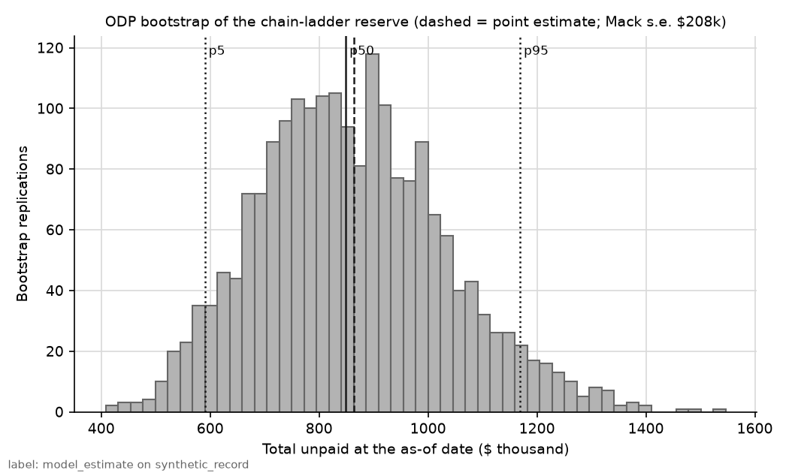

## Q4. How much is still owed on claims incurred but not yet paid?

**Who asks.** The payer's actuary (or the hospital's controller estimating receivables still to
collect).

**Data.** `mart.dev_triangle_at(d)`: the paid triangle as it could have been built on date \(d\),
with accident (service) months down the side and development lag in months across. Only claim
lines submitted and postings dated by \(d\) are used, net of reversals and recoupments, PLB rows
excluded. At the as-of date the triangle holds <!--n:q4.triangle_paid-->$58,550,706.63<!--/n-->, and its difference from the reconciled
paid total is <!--n:q4.triangle_tie-->$0.00<!--/n-->.

**Method.**

1. *Chain-ladder.* With cumulative paid \(C_{i,j}\) for accident month \(i\) at lag \(j\):
   \[
   \hat f_j = \frac{\sum_i C_{i,j+1}}{\sum_i C_{i,j}},\qquad \text{CDF}_j = \prod_{k \ge j} \hat f_k,\qquad
   \widehat{\text{Ult}}_i = C_{i,\text{latest}} \cdot \text{CDF}_{\text{latest}},
   \]
   unpaid \(= \widehat{\text{Ult}}_i - C_{i,\text{latest}}\), no tail factor (assumption). Here
   \(\hat f_0\) = <!--n:q4.f0-->5.05<!--/n--> and the lag-0 CDF is <!--n:q4.cdf0-->8.62<!--/n-->.
2. *Mack (1993) standard error* of the total reserve; the code reproduces the published
   Taylor-Ashe benchmark in a unit test.
3. *ODP bootstrap (England and Verrall 2002).* Pearson residuals of the incremental triangle are
   resampled into pseudo-triangles, chain-ladder is refitted to each and future cells are drawn
   from a gamma process.
4. *Bornhuetter-Ferguson with a Cape Cod expected ratio* (exposure = contract allowed on reported
   claims; expected ratio <!--n:q4.elr-->0.695<!--/n-->): \(\text{Unpaid}_i = \text{ELR}\cdot E_i\,(1 - 1/\text{CDF}_i)\).
5. *Frequency-severity.* Claim counts per payer and month as a Poisson GLM with over-dispersion
   tests; severity as gamma and lognormal.
6. *Retrospective test* at four earlier as-of dates, using only data known then.

**Results and validation.**

| Estimate | Value |
|---|---:|
| Chain-ladder unpaid | <!--n:q4.cl_unpaid-->$863,526<!--/n--> |
| Mack standard error (CV) | <!--n:q4.mack_se-->$208,351<!--/n--> (<!--n:q4.mack_cv-->24%<!--/n-->) |
| Bootstrap 5% to 95% | <!--n:q4.boot_p05-->$590,325<!--/n--> to <!--n:q4.boot_p95-->$1,168,996<!--/n--> |
| Bornhuetter-Ferguson (Cape Cod) | <!--n:q4.bf_unpaid-->$827,454<!--/n--> |
| Simulator's true unpaid (evaluation only) | <!--n:q4.true_unpaid-->$663,429<!--/n--> |
| Chain-ladder error / BF error | <!--n:q4.cl_error-->30%<!--/n--> / <!--n:q4.bf_error-->25%<!--/n--> |

The true value lies inside the 90% interval (inside = <!--n:q4.true_inside-->yes<!--/n-->), <!--n:q4.error_se-->0.96<!--/n--> standard errors from the
chain-ladder estimate. It is a single random outcome concentrated in few claims: the 10 largest
hold <!--n:q4.top10_share-->63%<!--/n--> of it. Month by month, <!--n:q4.months_inside-->6 of 10<!--/n--> recent accident months fall inside their own 90%
interval.

@@table:reserve_retro@@

Later payments fell inside the interval at <!--n:q4.retro_inside-->4 of 4<!--/n--> retrospective dates (the dates share data, so
these are not independent checks). Claim counts are Poisson (Pearson dispersion
<!--n:q4.poisson_dispersion-->0.87<!--/n-->); severity is heavy-tailed and grows with payment lag, because late payments come from
denied and appealed claims, which are larger.

{width=0.7}

Where chain-ladder breaks: the newest month is multiplied by a
development factor of <!--n:q4.cdf0-->8.62<!--/n-->, so one noisy month moves the whole estimate; a change in payment speed
would bias every factor; and a few large late claims make the true outcome lumpy. The
retrospective test showed the first problem directly, which is why Bornhuetter-Ferguson, which
leans on exposure for immature months, is reported beside it. Both still underestimate at
month-end dates, because claims served but not yet submitted are missing from the exposure: that
is true IBNR, which paid-only data cannot see.

**Limits.** No tail factor; a stationary simulated payment pattern; the triangle can develop only
what is visible, and a small share of payments reach the bank without a remittance line.
