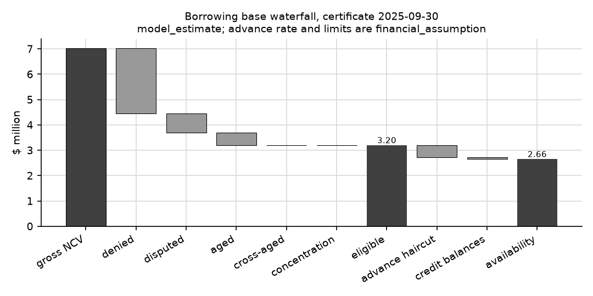

## Q5. How much can a bank lend against these receivables?

**Who asks.** A bank credit analyst preparing an asset-based revolving facility secured by the
hospital's receivables.

**Data.** Open claim lines at the certificate date, rebuilt point in time from the reconciled
postings (their total at the as-of date, <!--n:credit.open_total-->$2,837,491.10<!--/n-->, differs from `recon.claim_line_balance` by
<!--n:credit.tie_diff-->$0.00<!--/n-->); claim states from the event feed; collection ratios and write-off recoveries from the
previous year; SOFR <!--n:public.sofr-->3.91%<!--/n--> (FRED, public).

**Method.** The certificate is built the way a lender builds a borrowing-base certificate.

1. *Collateral value.* Billed charges are not collectible value; each line is valued at its net
   collectible value (NCV) using the payer's paid-to-billed ratio over the previous year.
2. *Eligibility waterfall* (first failing rule recorded): denied; disputed (appealed or pended);
   aged beyond <!--n:credit.max_age_days-->120<!--/n--> days since submission; cross-aged (all lines of a payer whose aged share of
   NCV exceeds a threshold).
3. *Concentration limit.* No payer may exceed <!--n:credit.concentration_limit-->30%<!--/n--> of the final eligible base, so the base
   solves the fixed point \(E = \sum_p \min(e_p, L\,E)\), found by iteration.
4. *Availability* = advance rate (<!--n:credit.advance_rate-->85%<!--/n-->) x eligible - credit balances owed back to payers.
5. *Expected loss* = \(\text{PD} \times \text{LGD} \times \text{EAD}\) per payer, with PD the NCV-weighted
   probability of write-off from the Markov chain (time-in-state corrected), LGD from recoveries on
   written-off claims and EAD the capped eligible NCV. Check: is expected loss below the lender's
   margin \((1 - \text{advance rate}) \times \text{eligible}\)?
6. *Interest-rate stress.* Facility rate = SOFR + spread (<!--n:credit.spread-->2.75%<!--/n-->, assumption), ACT/360, at base,
   +<!--n:credit.shock_small-->100<!--/n--> bp, +<!--n:credit.shock_large-->200<!--/n--> bp, <!--n:credit.slow_pct-->25%<!--/n--> slower payment, and both.

**Results.** At the as-of date the simulated hospital has not billed for three months, so almost
all open receivables are past the age limit: availability is <!--n:credit.asof_availability-->-$95,639<!--/n-->, a run-off book. The
steady-state certificate on <!--n:credit.certificate_date-->2025-09-30<!--/n-->:

@@table:credit_waterfall@@

Expected loss (<!--n:credit.expected_loss-->$662,340<!--/n-->) is larger than the lender's margin (<!--n:credit.lender_margin-->$480,736<!--/n-->): covered =
<!--n:credit.el_covered-->no<!--/n-->. With a 90-day age limit, availability would be <!--n:credit.sens90_availability-->$2,613,701<!--/n-->.

@@table:credit_stress@@

{width=0.8}

**Validation.** Following the steady-state eligible pool to the as-of date, predicted expected loss
was <!--n:credit.el_bt_predicted-->$662,340<!--/n--> and <!--n:credit.el_bt_realised-->$625,007<!--/n--> was actually written off; <!--n:credit.collected_share-->77.1%<!--/n--> of eligible NCV was collected.
Against the generator's ultimate outcome per claim, the NCV-weighted predicted PD is <!--n:credit.pd_ncv-->20.7%<!--/n--> and
the ultimate write-off share <!--n:credit.wo_ncv-->21.6%<!--/n-->. Count-weighted, PD is <!--n:credit.pd_count-->20.6%<!--/n--> against <!--n:credit.wo_count-->7.8%<!--/n-->: the PD
comes from a dollar-weighted chain, so the dollar comparison is the relevant one.

The finding that expected loss exceeds the margin is the useful
output of the certificate, not an embarrassment. It says that at a <!--n:credit.advance_rate-->85%<!--/n--> advance rate the lender is
not protected, because many claims that look current will be denied later. A credit analyst would
lower the advance rate, exclude payers with high denial rates, or require a reserve. The stress
test adds that a rate shock changes the cost of the facility much more than its size, while slower
payment shrinks availability by ageing the book.

**Limits.** The expected-loss backtest is not a clean hold-out: PD was switched to the
dollar-weighted chain after that backtest. Advance rate, age limit, concentration limit, spread and cross-age threshold are
assumptions, not a lender's terms. Government receivables, assignment of claims and dilution
reserves are not modelled. The certificate is only as good as the reconciliation beneath it.
