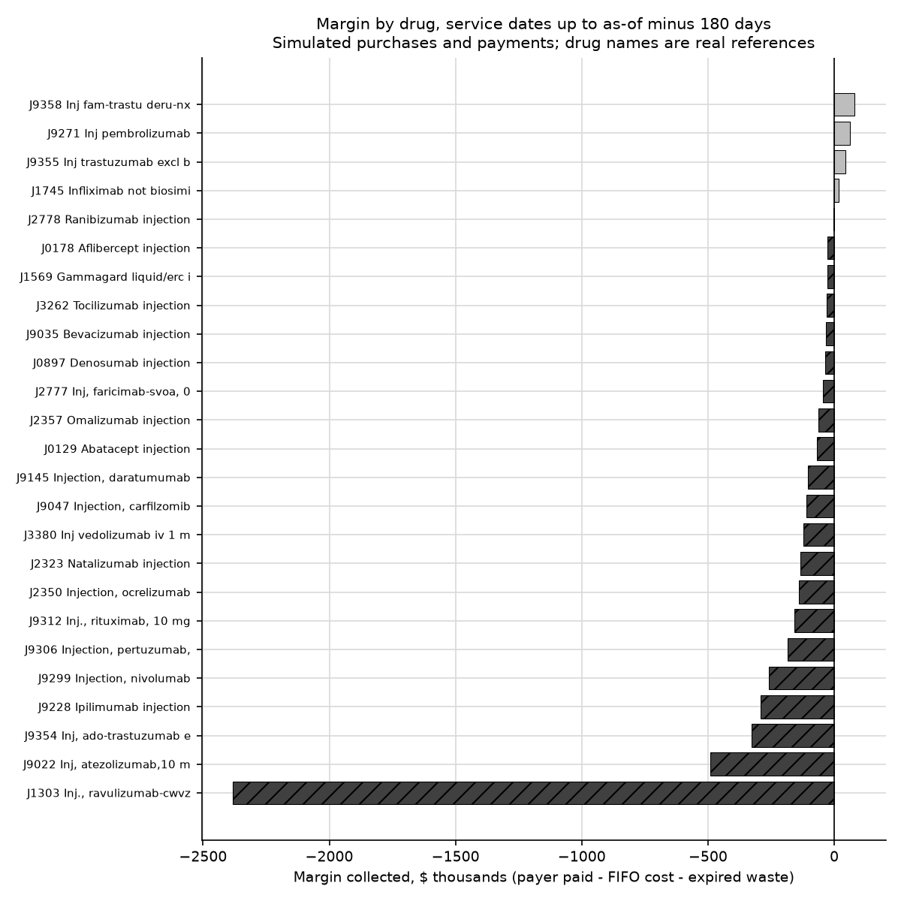

## Q6. Which drugs lose money after reimbursement?

**Who asks.** The pharmacy manager of the infusion centre.

**Data.** Purchase lots (`core.fact_drug_purchase`: units, invoice value, expiry), administrations
and expiry-waste events (`core.fact_drug_dispense`), the drug claim lines and their reconciled
balances and statuses. Reference price: the CMS Medicare Part B payment limit per billing unit for
<!--n:public.n_drugs-->25<!--/n--> J-codes, <!--n:public.asp_quarter-->2026Q4<!--/n--> file (`published_aggregate`). Purchase prices, volumes and payments are simulated.

**Method.**

1. *FIFO lot costing in SQL, without loops* (`sql/models/61_drug_fifo.sql`). Expired-waste events
   are charged to their own lot. Each lot gets a range on the drug's cumulative-units axis in
   receipt order, \(\text{cum\_end} = \sum \text{capacity}\) over lots ordered by receipt, and each
   administration a range in time order. An administration takes from a lot the overlap
   \(\min(\text{ends}) - \max(\text{starts})\) whenever the ranges overlap.
2. *Cents that tie.* Inside a lot of value \(V\) and \(U\) units, pieces with cumulative units
   \(q_1, \dots, q_n = U\) cost
   \(\text{cost}_k = \operatorname{round}(V q_k / U) - \operatorname{round}(V q_{k-1} / U)\), which
   telescopes to exactly \(V\).
3. *Margin per drug*, for service dates at least <!--n:q6.mature_days-->180<!--/n--> days before the as-of date (an assumption):
   margin = payer paid - FIFO cost - expired cost, split exactly into contract minus cost, waste,
   denials, pending payment, patient share and pricing below contract.

**Validation.** The identity purchased = administered + expired + on hand holds on all <!--n:q6.n_lots-->1,292<!--/n--> lots in
units (<!--n:q6.lot_identity_units-->yes<!--/n-->) and to the cent (<!--n:q6.lot_identity_value-->yes<!--/n-->):

| Quantity | Units | Dollars |
|---|---:|---:|
| Purchased | <!--n:q6.units_purchased-->885,324<!--/n--> | <!--n:q6.usd_purchased-->$47,252,467.95<!--/n--> |
| Administered (FIFO cost) | <!--n:q6.units_administered-->823,394<!--/n--> | <!--n:q6.usd_administered-->$44,017,867.00<!--/n--> |
| Expired | <!--n:q6.units_expired-->3,154<!--/n--> | <!--n:q6.usd_expired-->$89,817.65<!--/n--> |
| On hand | <!--n:q6.units_on_hand-->58,776<!--/n--> | <!--n:q6.usd_on_hand-->$3,144,783.30<!--/n--> |

Against the generator's physical lot records, <!--n:q6.lots_exact_share-->99.38%<!--/n--> of lots agree on every quantity; the rest
differ only because the generator consumes first-expiry-first-out while FIFO goes by receipt date.
FIFO cost (<!--n:q6.fifo_cost-->$42,558,392.10<!--/n-->) is almost identical to the cost of the lot each pharmacist recorded
(<!--n:q6.si_cost-->$42,558,392.75<!--/n-->), because the simulated price changes only once. A hand-worked test covers a partial lot,
an expiry, thirds of a cent and later data not moving earlier allocations.

**Results (mature cohort).** <!--n:q6.n_losing-->21<!--/n--> of <!--n:q6.n_drugs-->25<!--/n--> drugs lose money before patient share
(<!--n:q6.n_losing_if_patient_pays-->12<!--/n--> if every patient share were collected); total margin <!--n:q6.margin-->-$4,830,912.70<!--/n-->. Contract rates
cover cost by <!--n:q6.price_gap-->$12,264,030.41<!--/n-->, so the loss does not come from acquisition price. It comes from denied drug
claims (<!--n:q6.denied_leak-->$12,791,364.27<!--/n--> of contract value), then patient share not counted as collected
(<!--n:q6.patient_resp-->$3,471,232.73<!--/n-->). The largest loss is <!--n:q6.top_loser-->J1303<!--/n--> (<!--n:q6.top_loser_name-->Inj., ravulizumab-cwvz 10 mg<!--/n-->), <!--n:q6.top_loser_margin-->-$2,382,174.03<!--/n-->, with <!--n:q6.top_loser_denied_share-->34%<!--/n--> of its lines
denied. One payer-level price problem exists: P04's contract rate is below FIFO cost for <!--n:q6.p04_below_cost-->11<!--/n--> drugs.

@@table:drug_losers@@

{width=0.78}

<!-- [Thuc: rewrite in your own words] --> Be careful with the headline. In the simulator, denial odds rise
with claim amount, so the most expensive drug is denied most often by construction, and purchase
prices are a fixed ratio of the CMS limit, so the cost picture is built in. What the analysis
demonstrates is the method: an exact, auditable FIFO in SQL and a margin decomposition that tells
the pharmacy manager whether to talk to purchasing, to the denial team or to contracting.

**Limits.** No partial-vial (JW) waste records; patient share treated as not collected; denials in
the cohort include some still under appeal; the ASP limit is a Medicare reference, not cost.
