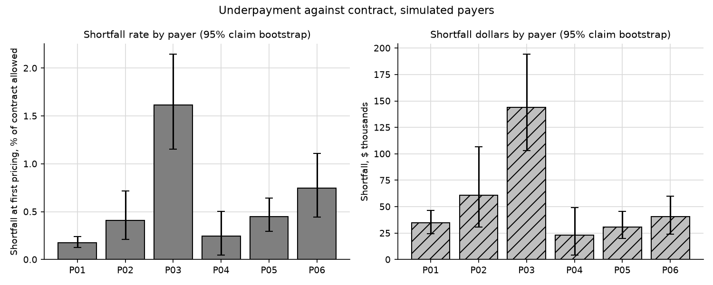

## Q7. Which payers underpay against contract, by how much, and why would they?

**Who asks.** A consulting economist advising the hospital before contract renewals. The full
recommendation is in the two-page memo `docs/consulting_memo.md`.

**Data.** Reconciled claim-line balances (contract expected allowed, payer allowed, paid, patient
share), matched remittance lines for first versus later pricing (PLB rows excluded), appeal outcomes
from the event feed, monthly mean SOFR from FRED (`observed_public`).

**Method.**

1. *Underpayment in allowed terms.* For each line the payer priced,
   shortfall = contract allowed - first payer allowed, if at least one cent. Comparing allowed,
   not paid, keeps deductibles and coinsurance out of the shortfall. Lines are classified as
   priced below contract, reduced after payment, pending, overpaid or at contract; denials are
   excluded (they are Q2).
2. *Intervals.* Percentile bootstrap with <!--n:q7.bootstrap_reps-->2,000<!--/n--> replicates that resamples **whole claims**,
   because all lines of a claim share one pricing decision; each statistic is a ratio of resampled
   sums.
3. *Value of float.* \(\text{float} = \text{paid} \times r \times \text{days}/365\), with \(r\) the
   month's mean SOFR and days from submission to first payment; "late" means beyond an assumed
   <!--n:q7.prompt_pay_days-->30<!--/n-->-day window.
4. *Incentives.* A payer that underprices by \(s\) keeps it unless the hospital appeals (probability
   \(q\)) and wins (\(w\)); if it loses it repays \(s\) plus a penalty \(\pi s\). Its expected gain is
   \(s\,[1 - q w (1 + \pi)]\) (less its own handling cost), so underpricing stops paying only if
   \(\pi \ge 1/(q w) - 1\). The hospital appeals when \(w s > c\), a threshold \(s^* = c / w\) with
   appeal cost \(c\) = <!--n:q7.appeal_cost-->$45<!--/n--> (assumption) and \(w\) each payer's appeal win rate
   (<!--n:q7.pwin_min-->36%<!--/n--> to <!--n:q7.pwin_max-->48%<!--/n-->). Repeated game: with a renewal weight \(\delta\), underpricing stops
   paying once the expected loss at renewal exceeds the annual gain times \((1-\delta)/\delta\).

**Results.**

@@table:econ_payers@@

Total shortfall at first pricing is <!--n:q7.shortfall-->$334,486.29<!--/n-->. <!--n:q7.top_payer-->P03<!--/n--> stands out at <!--n:q7.top_rate-->1.61%<!--/n--> of contract value
(95% interval <!--n:q7.top_rate_ci-->1.15% to 2.15%<!--/n-->), <!--n:q7.p03_share-->13.9%<!--/n--> of its priced claims; its interval does not overlap the others,
whose order is not reliable. Float at SOFR is <!--n:q7.float_total-->$363,534.00<!--/n-->, of which <!--n:q7.float_late-->$179,197.70<!--/n--> is beyond the window.
Appeal thresholds run from <!--n:q7.threshold_min-->$93.23<!--/n--> to <!--n:q7.threshold_max-->$126.40<!--/n-->; <!--n:q7.above_threshold-->$300,904.07<!--/n--> of the shortfall sits above them,
with expected net recovery of <!--n:q7.net_recovery-->$104,252.32<!--/n--> after appeal costs. To deter underpricing a payer appealed
on every claim would have to repay <!--n:q7.penalty_min-->1.07<!--/n--> to <!--n:q7.penalty_max-->1.81<!--/n--> times the shortfall on top, far more than an
interest clause adds.

{width=0.78}

**Validation.** Line flags match the generator with precision <!--n:q7.flag_precision-->0.9988<!--/n--> and recall <!--n:q7.flag_recall-->1.0000<!--/n-->. The planted
underpayment probability lies inside the 95% interval for <!--n:q7.planted_share_inside-->5<!--/n--> of 6 payers and the planted mean
shortfall for <!--n:q7.planted_mean_inside-->6<!--/n--> of 6; formula tests cover the threshold, the deterrence penalty and the
repeated-game bound.

<!-- [Thuc: rewrite in your own words] --> The economics in one paragraph: if being caught only means paying
what was owed anyway, underpaying is a free option for the payer, because it keeps the money
whenever the hospital does not appeal or loses. Recovery alone never deters. An interest clause
above the payer's cost of funds removes the gain from paying late, but it is tiny next to the
shortfall itself, so it does not deter underpricing. What changes the payer's calculation is a
penalty that is a multiple of the shortfall, or a credible cost at contract renewal, which is why
documented, aggregated evidence matters more than one-off appeals.

**Limits.** Simulated underpayments are random draws, so the data cannot show strategic behaviour;
the real-data test would be bunching of shortfalls just below the appeal threshold. The win
probability for disputes is borrowed from denial appeals. The window, the clause rate and the
renewal weight are illustrative assumptions. SOFR understates a payer's return on held cash. No
causal claim is made.
